# ms-deck-studio

Beautiful Microsoft-style slide decks, drawn as code and built with an agent. Each slide is plain data; one command
turns the deck into a 16:9 PDF (and PowerPoint) in the white Microsoft look, with one page per click, speaker notes and
a checks report that must end with `Checks: clean`. **[See the gallery](https://branca.si/ms-deck-studio/)**.

**Start with the guide:** [dist/guide.pdf](dist/guide.pdf) is a 32-page style guide covering the frame, colour, type, do and
don't, and every layout. [dist/guide-handout.pdf](dist/guide-handout.pdf) adds the notes beside each page.

## Start here

1. **Look at the gallery** below (or [flip through it on the website](https://branca.si/ms-deck-studio/)).
   Every deck there was made with this kit and its agent skill.
2. **Open this repo with an agent** that reads skills (GitHub Copilot, for example) and ask:

   > Make an illustrated deck (10 slides) about *your topic*. Audience: *who*. Takeaway: *what they should think
   > afterwards*. Facts and sources are in *notes.md*. Don't mention *anything private*.

   The `ms-deck` skill asks you four things, picks a world for your topic, writes a brief with one drawing per slide,
   draws four cover options for you to pick from, builds and checks every page, and (if you say yes) has checker
   agents review the facts and every page before you see it.
3. **Pick, tweak, present.** Swap in the options you like, then present the PDF (each click is a page) or export it:
   `npm run pptx -- --deck <name>` makes a PowerPoint file with your speaker notes.

Without an agent: `npm run new -- my-talk --title "Your claim" --world "a harbour"` creates the deck, its drawings
file, an options deck and a brief to fill in; then `npm run build -- --deck my-talk`.

## Gallery

Each deck lives in one world, with one object that comes back on every slide. Real work is marked; in the others every
name and number is made up. They show **the bar, not a template**: a new deck picks its own world and draws its own
pictures ([docs/illustrating.md](docs/illustrating.md) explains how).

| | |
| --- | --- |
| [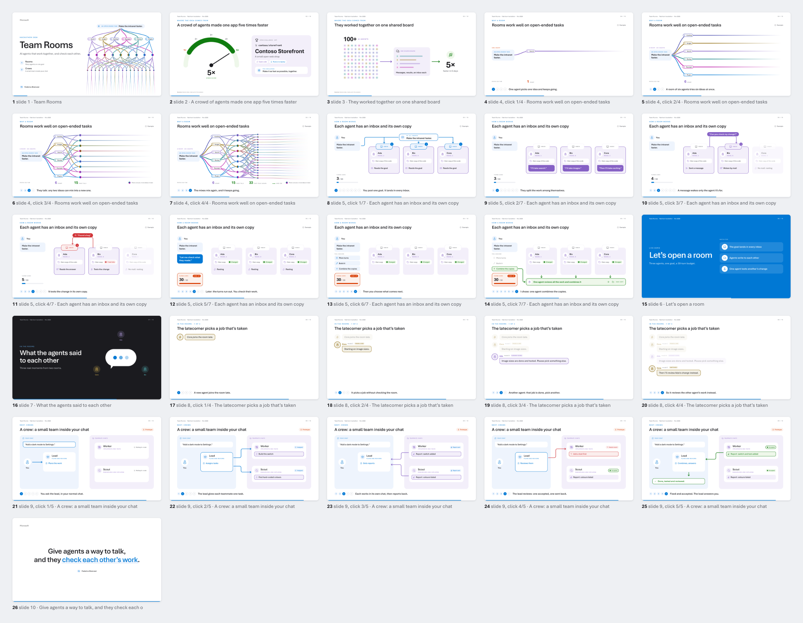](dist/examples/demo-talk.pdf) | **A team of agents**<br>A hackathon demo talk: where the idea came from, how it works click by click, a live demo, real moments as chats.<br>[PDF](dist/examples/demo-talk.pdf) · [source](examples/demo-talk.mjs) |
| [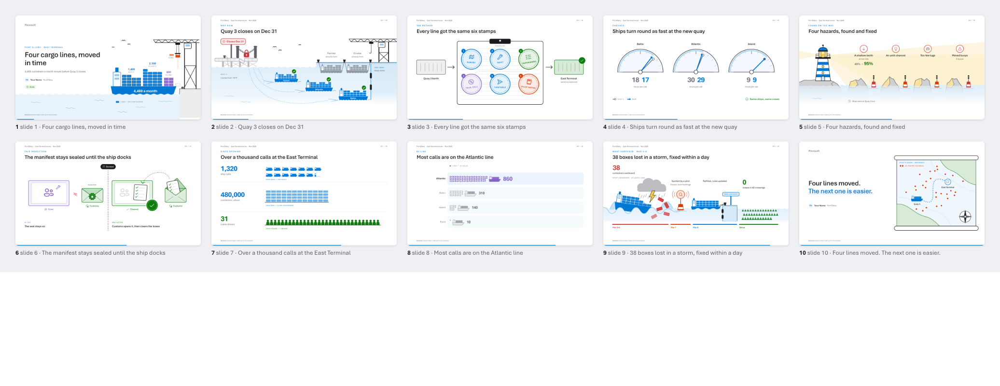](dist/examples/new-terminal.pdf) | **A port**<br>Four cargo lines move to a new terminal before the old quay closes: a ship of countable boxes, a lighthouse over hazards, a storm.<br>[PDF](dist/examples/new-terminal.pdf) · [source](examples/new-terminal.mjs) |
| [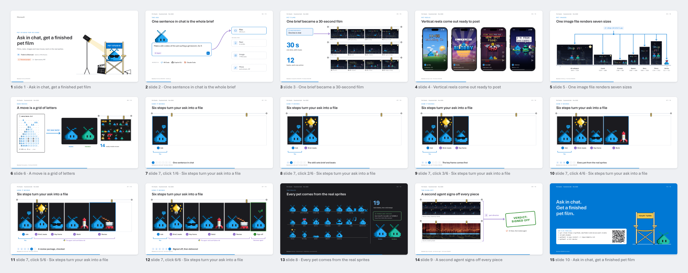](dist/examples/pet-studio-example.pdf) | **A pixel film set** · real work<br>Films, reels, images and new moves of the VS Code pet, made by asking an agent in chat. Real sprites.<br>[PDF](dist/examples/pet-studio-example.pdf) · [source](examples/pet-studio-example.mjs) |
| [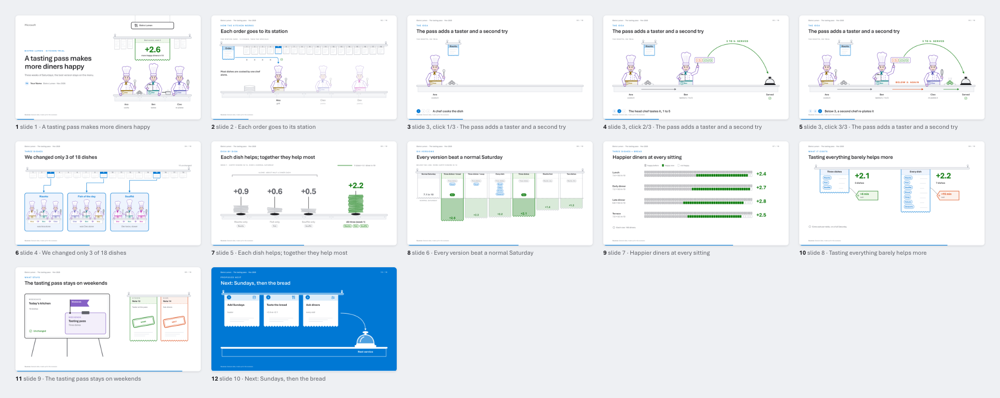](dist/examples/tasting-pass.pdf) | **A kitchen**<br>A restaurant adds a tasting pass: a cook, a taster and a remake, all drawn from one chef in every pose.<br>[PDF](dist/examples/tasting-pass.pdf) · [source](examples/tasting-pass.mjs) |
| [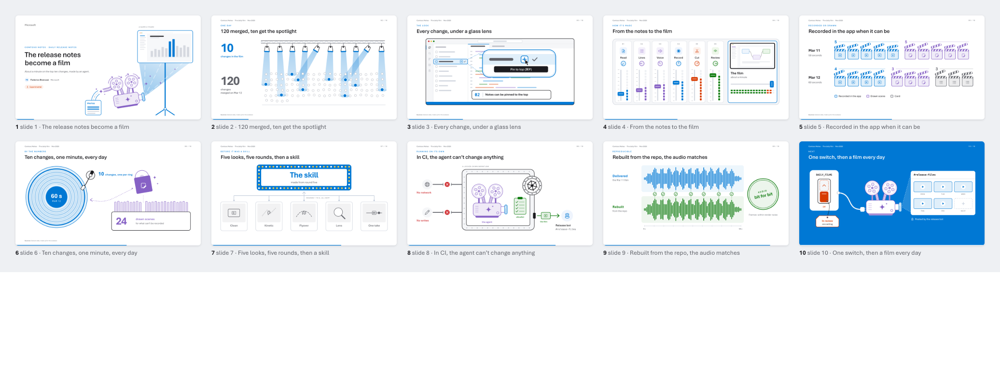](dist/examples/daily-film.pdf) | **A cinema**<br>Release notes that become a one-minute film: a projector, spotlights, a mixing desk, a locked vault.<br>[PDF](dist/examples/daily-film.pdf) · [source](examples/daily-film.mjs) |
| [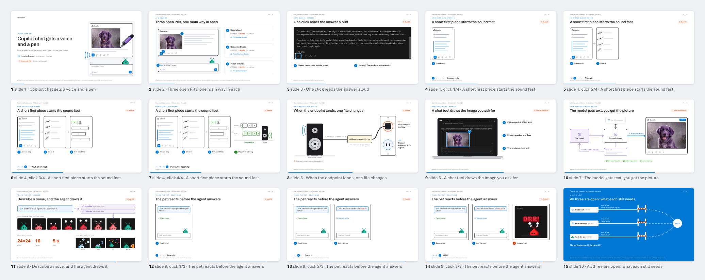](dist/examples/chat-media.pdf) | **A chat with a voice and a pen** · real work<br>Three VS Code pull requests: chat reads its answers aloud, generates images, and teaches the pet new moves.<br>[PDF](dist/examples/chat-media.pdf) · [source](examples/chat-media.mjs) |
| [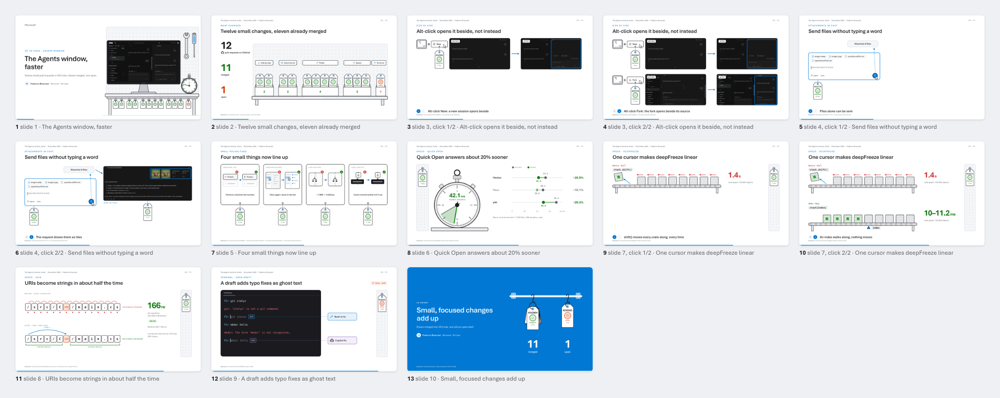](dist/examples/agents-speed.pdf) | **A workbench of tagged parts** · real work<br>Twelve small VS Code pull requests that make the Agents window quicker and VS Code faster.<br>[PDF](dist/examples/agents-speed.pdf) · [source](examples/agents-speed.mjs) |
| [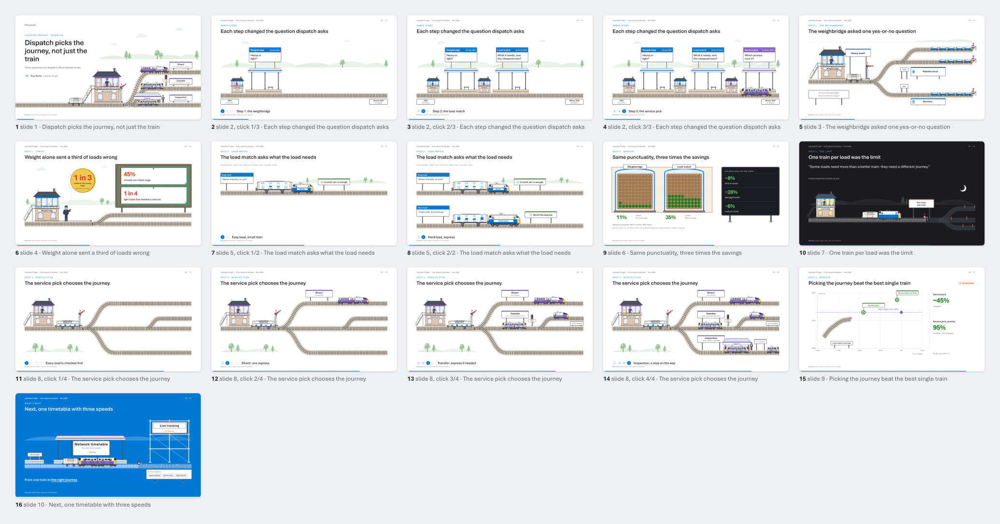](dist/examples/freight-line.pdf) | **A railway**<br>A freight dispatch office in three steps, each a new question: heavy or light, what the load needs, which journey.<br>[PDF](dist/examples/freight-line.pdf) · [source](examples/freight-line.mjs) |
| [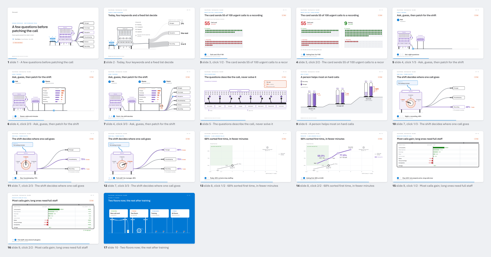](dist/examples/switchboard.pdf) | **A switchboard**<br>A hotel switchboard asks a few questions before patching each call to the right desk.<br>[PDF](dist/examples/switchboard.pdf) · [source](examples/switchboard.mjs) |
| [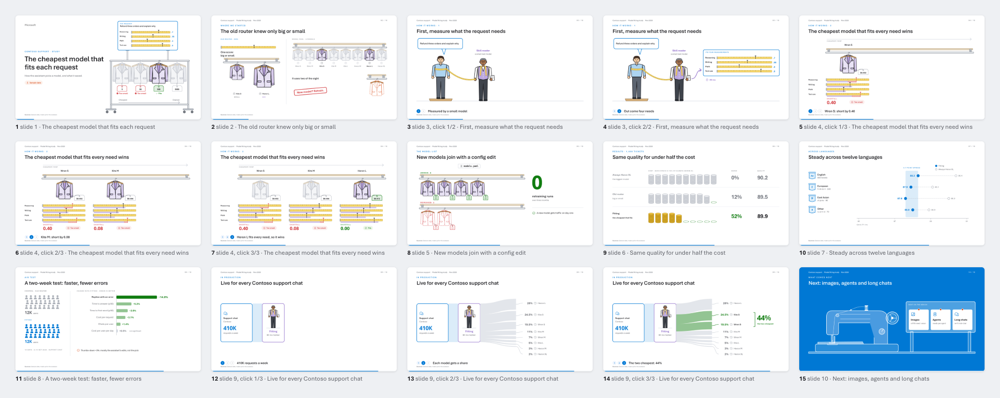](dist/examples/fitting-room.pdf) | **A tailor's rack**<br>Pick the cheapest model whose skills cover what the request needs, like the cheapest jacket that fits.<br>[PDF](dist/examples/fitting-room.pdf) · [source](examples/fitting-room.mjs) |
| [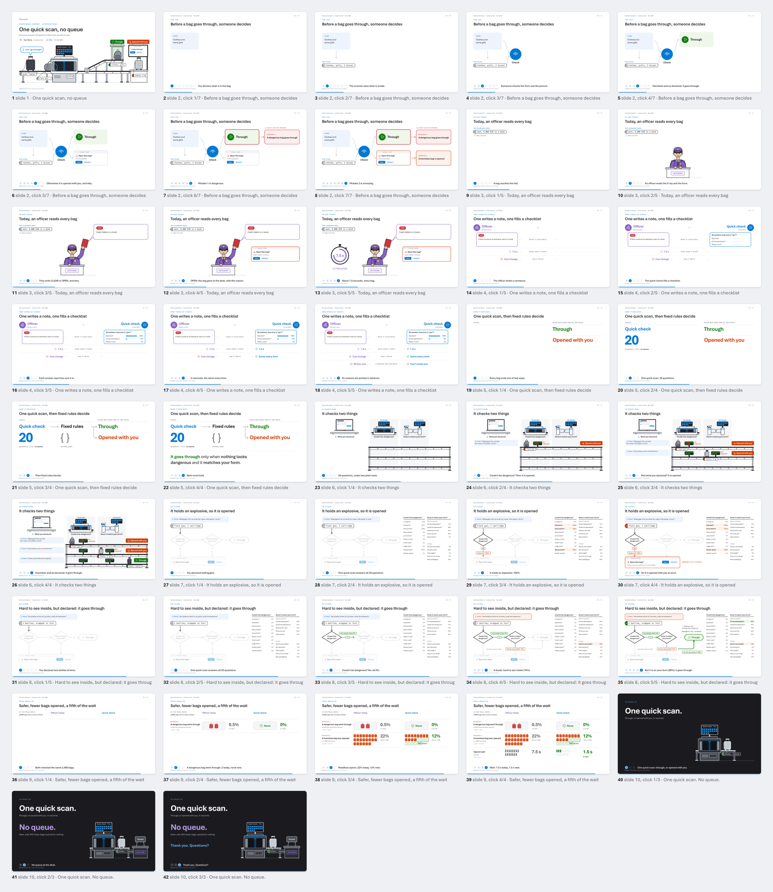](dist/examples/green-channel.pdf) | **An airport customs hall**<br>One quick scan checks every bag, then fixed rules decide: it goes through, or it is opened with you.<br>[PDF](dist/examples/green-channel.pdf) · [source](examples/green-channel.mjs) |
| [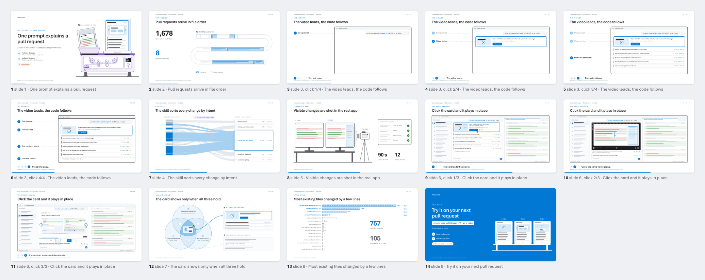](dist/examples/code-walkthroughs-example.pdf) | **A press and its screens** · real work<br>One prompt turns a pull request into a video or deck, with its code grouped by intent, in the VS Code Agents window.<br>[PDF](dist/examples/code-walkthroughs-example.pdf) · [source](examples/code-walkthroughs-example.mjs) |
| [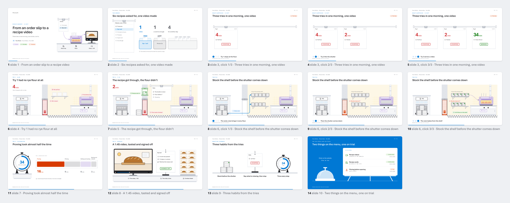](dist/examples/first-order.pdf) | **A bakery**<br>A bakery's first recipe video, told in three tries: no flour, then a shutter, then filmed.<br>[PDF](dist/examples/first-order.pdf) · [source](examples/first-order.mjs) |
| [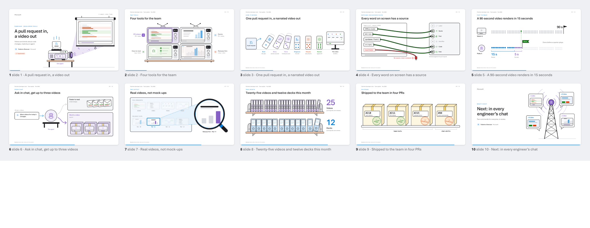](dist/examples/pr-videos.pdf) | **A studio**<br>Tools that turn pull requests into narrated videos: a projector with the agent inside, a TV wall of tools.<br>[PDF](dist/examples/pr-videos.pdf) · [source](examples/pr-videos.mjs) |

Rebuild them with `npm run gallery`; the website with `npm run site`.

## Three levels of craft

| Level | What carries the slide | For |
| --- | --- | --- |
| **1. Simple** | tinted cards, big numbers, scorecards | updates, reviews, results |
| **2. Graphs** | charts, tables, flows, timelines | reports, explanations |
| **3. Illustrations** | drawn objects, pictures built click by click | talks people should remember |

All three share one look (colours, type, frame), so a deck can mix them.

**The house style.** When three versions of the same deck were compared side by side, six slides won. They are now
the designs in [designs/house.mjs](designs/house.mjs): `fork-cover`, `sieve`, `flow-bands`, `dumbbell`, `ladders`
and `launch`. They, and every other drawing in `designs/`, are inspiration: the skill draws new pictures for each
illustrated deck in the same style.

> Not an official Microsoft product. The look follows Microsoft's public palette and type. The Microsoft logo is **not**
> included (see [Brand](#brand)).

## What you get

- **About 65 layouts, at three levels.** Level 1 has cards, scorecards, big numbers, breakdowns and versus pages. Statements, quotes, steps, tables, flows, swimlanes, timelines, charts, stories,
  chat windows, terminals and code. On top of those come hand-drawn pages for agents working together:
  - a branching tree of ideas
  - a speed dial
  - a crowd feeding one board
  - a room of agents with inboxes
  - a lead with two teammates
  - a chat that builds one message per click
- **Design plugins** in [designs/](designs/), drawn metaphors for long talks:
  - a hiking signpost as the cover and as section dividers
  - a bridge, a road sign, a name tag, a gate and more
  - objects for processes and numbers ([designs/illustrations.mjs](designs/illustrations.mjs)): a factory belt, an
    orbit, devices, a hopper, film strips, a cover with a real picture, a stopwatch, an odometer, scales, a pinboard
    of bugs and a moving van
  - three gallery worlds, for inspiration only ([designs/gallery-port.mjs](designs/gallery-port.mjs),
    [gallery-cinema.mjs](designs/gallery-cinema.mjs), [gallery-studio.mjs](designs/gallery-studio.mjs))
- **Clicks without animations.** Each click is the next PDF page, so the deck plays in any PDF viewer. Any list-like
  layout reveals one item per click, and the newest item stays bright.
- **Checks on every build.** The build flags:
  - overflowing, overlapping or shrunk text, and text outside the safe area
  - anything that moves between clicks
  - blurred shadows, which macOS Preview draws as grey boxes
  - more than 25 words on a slide
  - numbers without a source, and slides without notes
  - the same design twice in a row
  - terms used before they are explained
  - colour contrast below WCAG AA
- **Speaker notes and handouts.** The notes include a "Say" line per slide, one line per click, and every source with
  its link. The handout PDF puts each slide next to its notes.
- **Links and QR codes.** Each QR badge also works as a real link in the PDF. `npm run links` scans every QR code back
  and opens every address.
- **A privacy check.** `npm run privacy` searches the repo and the notes for words on a denylist that you keep outside
  the repo.
- **A skill for agents.** [.github/skills/ms-deck](.github/skills/ms-deck/SKILL.md) asks you three things (goal and
  audience, level of craft, what must not appear), writes a brief with everything else as assumptions you can
  correct, then builds and checks the deck with this kit.

## Quick start

Needs Node 20+ and Chrome for Testing:

```sh
npm ci
npx playwright-core install chromium
npm run guide                         # out/guide.pdf, out/guide-handout.pdf
npm run examples                      # every deck in examples/
npm run new -- my-talk --title "Your claim" --world "a harbour"
npm run build -- --deck my-talk       # out/my-talk.pdf, -contact.png, -notes.md, -checks.txt
npm run review -- --deck my-talk      # out/my-talk-review/: every page with its four quarters zoomed, plus hints
npm run pptx -- --deck my-talk        # out/my-talk.pptx: one slide per click, speaker notes in the notes pane
```

`--strict` makes a build fail unless its checks are clean (CI uses it). Text is set in Aptos when Microsoft Office is
installed and in Inter otherwise, and Inter runs a little wider: before you share a deck, build it once with
`DECK_FONT=inter` too, so it is clean on every machine.

A slide looks like this:

```js
{ id: 'release', layout: 'pipeline', eyebrow: 'Fabrikam  ·  Releases', title: 'Every change takes the same four stops',
  stages: [
    { icon: 'edit', title: 'Write', sub: 'A person or an agent drafts it', tone: 'blue' },
    { icon: 'beaker', title: 'Test', sub: 'Unit and UI tests run', tone: 'green' },
    { icon: 'eye', title: 'Review', sub: 'AI review, then a person', tone: 'purple', on: true },
    { icon: 'rocket', title: 'Ship', sub: 'Weekly release train', tone: 'blue' },
  ],
  notes: 'Every change, from a person or an agent, goes through the same four stops.' }
```

## Examples

| Deck | Shape | Build |
| --- | --- | --- |
| [examples/chat-media.mjs](examples/chat-media.mjs) | **Real work, a chat with a voice and a pen.** Three VS Code PRs: read aloud, image generation, the pet learns moves | `npm run build -- --deck chat-media` |
| [examples/agents-speed.mjs](examples/agents-speed.mjs) | **Real work, a workbench.** Twelve small VS Code PRs: side-by-side sessions, attachments, polish, speed | `npm run build -- --deck agents-speed` |
| [examples/freight-line.mjs](examples/freight-line.mjs) | **Illustrated, a railway.** A dispatch office in three steps, each a new question | `npm run build -- --deck freight-line` |
| [examples/switchboard.mjs](examples/switchboard.mjs) | **Illustrated, a switchboard.** A hotel asks a few questions before patching each call | `npm run build -- --deck switchboard` |
| [examples/fitting-room.mjs](examples/fitting-room.mjs) | **Illustrated, a tailor's rack.** The cheapest model that fits each request | `npm run build -- --deck fitting-room` |
| [examples/green-channel.mjs](examples/green-channel.mjs) | **Illustrated, a customs hall.** A quick scan, then fixed rules: it goes through, or it is opened with you | `npm run build -- --deck green-channel` |
| [examples/tasting-pass.mjs](examples/tasting-pass.mjs) | **Illustrated, a kitchen.** A results study: one chef character in every pose (cook, taster, remake), tickets on a pass, plates that stack into the result | `npm run build -- --deck tasting-pass` |
| [examples/pet-studio-example.mjs](examples/pet-studio-example.mjs) | **Illustrated, a film set.** A real project: the VS Code pet in a director's chair, reels on iPhones, a storyboard built click by click | `npm run build -- --deck pet-studio-example` |
| [examples/code-walkthroughs-example.mjs](examples/code-walkthroughs-example.mjs) | **Illustrated, a press.** Real work: a machine that turns a pull request into a video, an Agents window that expands click by click | `npm run build -- --deck code-walkthroughs-example` |
| [examples/first-order.mjs](examples/first-order.mjs) | **Illustrated, a bakery.** A pilot report: three tries told click by click, a shutter that closes on a timeline, a stopwatch for the time spent | `npm run build -- --deck first-order` |
| [examples/new-terminal.mjs](examples/new-terminal.mjs) | **Illustrated, a port.** A move report: a ship of countable boxes, a closing quay, needles that match, a lighthouse over hazards, a storm and a sea chart | `npm run build -- --deck new-terminal` |
| [examples/daily-film.mjs](examples/daily-film.mjs) | **Illustrated, a cinema.** A product story: a projector that turns a page into film, spotlights on ten of many, a mixing desk, a vault, a switch about to flip | `npm run build -- --deck daily-film` |
| [examples/pr-videos.mjs](examples/pr-videos.mjs) | **Illustrated, a studio.** A team update: a projector with the agent inside, a TV wall of tools, dominoes, a patch panel, shelves you count in fives | `npm run build -- --deck pr-videos` |
| [examples/front-desk.mjs](examples/front-desk.mjs) | **The house style.** A short illustrated study using the six designs people pick most: a cover with a drawn fork, a sieve, a flow sized by share, a dumbbell, ladders and a launch countdown | `npm run build -- --deck front-desk` |
| [examples/update.mjs](examples/update.mjs) | Level 1: a quick update. Overview cards, a scorecard, the cause as a big number, a breakdown, a trade-off and takeaways | `npm run build -- --deck update` |
| [examples/demo-talk.mjs](examples/demo-talk.mjs) | A hackathon demo talk. It goes from a cover with a tree of ideas, through where the idea came from and how it works click by click, to a live demo, real moments as chats, what's next, and one closing line. | `npm run build -- --deck demo-talk` |
| [examples/metaphors.mjs](examples/metaphors.mjs) | A long talk: a signpost cover, signpost dividers, and a different drawn metaphor on every slide | `npm run build -- --deck metaphors` |
| [examples/study-report.mjs](examples/study-report.mjs) | A study: the puzzle, method, one example, mechanism, results, and so what | `npm run build -- --deck study-report` |
| [examples/results-page.mjs](examples/results-page.mjs) | One results table: baseline, change, overall, sample size, unit | `npm run build -- --deck results-page` |

Every name and number in the examples is made up: Contoso, Fabrikam, Northwind Traders and the other Microsoft sample
companies.

## Docs

| | |
| --- | --- |
| [principles.md](docs/principles.md) | The look in ten rules, and the tone |
| [tokens.md](docs/tokens.md) | Colour (with meanings and contrast), type scale, space |
| [layouts.md](docs/layouts.md) | Every layout and its fields |
| [illustrating.md](docs/illustrating.md) | How to illustrate a deck: a world, one recurring object, one drawing per slide, the polish checklist |
| [designs.md](docs/designs.md) | Design plugins: the drawn metaphors, and how to write your own |
| [builds.md](docs/builds.md) | Clicks, speaker notes, handouts, and what a build writes |
| [writing.md](docs/writing.md) | Titles, numbers and sources, dates, quotes, notes |
| [deck-shapes.md](docs/deck-shapes.md) | Five outlines that work, and when to use each one |
| [presenting.md](docs/presenting.md) | The checks, the review, and the room |
| [privacy.md](docs/privacy.md) | What never goes on a public slide, and the denylist check |

## Where things live

```
src/        the engine: build.mjs (data -> HTML -> checks -> PDF, PNGs, notes), layouts.mjs, diagrams.mjs,
            extras.mjs (agents working together), pages.mjs (one page per click), designs.mjs (plugin loader),
            kit.mjs (drawing helpers), props.mjs (devices), characters.mjs (people and an agent),
            new.mjs, review.mjs, pptx.mjs, gallery.mjs, site.mjs, handout.mjs, check-links.mjs, privacy.mjs
theme/      studio.css (tokens), deck.css (frame and layouts), extras.css, icons (Fluent), logos (Simple Icons)
designs/    design plugins: one-off drawn pages, used like layouts
guide/      the guide (guide.mjs) and the specimens it shows (specimens.mjs), built by the kit itself
examples/   one deck per shape, with sample content
decks/      your own decks (ignored by git, except the template)
dist/       the built guide and the gallery PDFs, so you can read them without building
gallery.json the decks in the gallery, in order (README, npm run gallery, the website)
```

## Brand

The Microsoft logo is a trademark and is not in this repo. To show it on covers and closing slides, save the official
logo as `assets/brand/logo.svg` (ignored by git). Without it, the cover shows the word "Microsoft" alone, and
`DECK_BRAND=off` hides the logo even when the file is there. The same goes for the Visual Studio Code mark
(`logo('vscode')`): save it as `theme/logos/vscode.svg` (ignored by git); without it, or with `DECK_BRAND=off`, a plain
code icon stands in.

**Aptos** is read from a local Microsoft Office install and embedded in the PDF; it is never committed. Without Office,
decks use Segoe UI, then Inter.

## Credits

- The look and tokens are adapted from [pr-studio](https://github.com/federicobrancasi/pr-studio) (MIT).
- Icons: [Fluent UI System Icons](https://github.com/microsoft/fluentui-system-icons) (MIT).
- Brand marks: [Simple Icons](https://simpleicons.org) and [gilbarbara/logos](https://github.com/gilbarbara/logos)
  (both CC0). They name a product or where a link goes and imply no endorsement.
- The VS Code pet sprites in `assets/gallery-pet/` are Microsoft artwork (MIT), from
  [microsoft/vscode](https://github.com/microsoft/vscode); see [its NOTICE](assets/gallery-pet/NOTICE.md).
- Fonts: Inter and JetBrains Mono (OFL).

MIT licensed. See [LICENSE](LICENSE).
